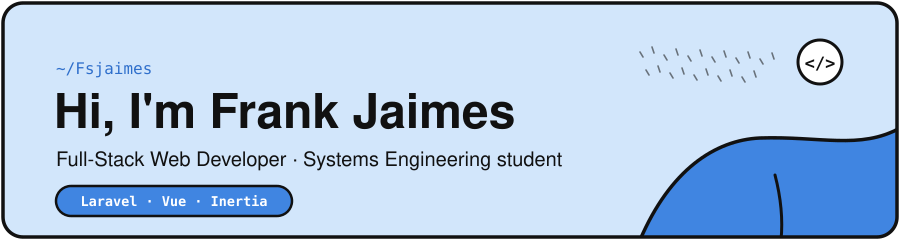

👋 About me

I'm a Full-Stack Web Developer and Systems Engineer from Colombia. I build web applications end to end, mostly with Laravel, Vue and Inertia.
I enjoy turning business processes into clean, maintainable software.

💼 Building web platforms with a development team
🎓 Systems Engineer
🌱 Always learning about software architecture and good practices

🛠️ Technologies

 

 

📊 Statistics

